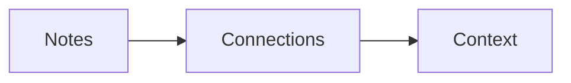

# Reading, embeds and media

**Reading** and the rendered half of **Live preview** support Markdown tables, tasks, footnotes, callouts, highlighted code, math and local embeds. These controls are available in the browser workspace for server vaults. Native v0.8.1 uses its existing source editor; it does not include these viewers.

## Callouts, code and math

Use a blockquote with a marker on its first line:

```md
> [!TIP]- Keep the context
> Decisions are easier to understand beside their reasons.
```

The `-` starts collapsed, `+` starts expanded, and no suffix creates an ordinary callout. Supported types are `note`, `info`, `tip`, `warning`, `danger`, `success`, `question`, `example`, `quote` and `bug`. Unknown markers remain ordinary blockquotes. Titles retain inline Markdown; expand a collapsible title with the mouse, Enter or Space.

Fenced code with a language such as `javascript`, `typescript`, `python`, `rust`, `json` or `bash` receives highlighting and a **Copy code** button. Unknown languages and fences larger than 20,000 characters stay plain. No language is guessed. Copied code is literal text, never executed.

Write inline math as `$E=mc^2$` and display math between lines containing `$$`. KaTeX uses locally bundled fonts. Trusted commands such as HTML, links and remote images are disabled. A preview processes at most 80 formulas, 4,000 characters per formula and 20,000 formula characters in total; excess formulas remain source. Expansion and size limits also apply. See [KaTeX options](https://katex.org/docs/options.html).

Footnotes use `[^name]` and `[^name]: Footnote text`. Their identifiers are unique across split panes and embedded notes. Heading links such as `[Decisions](#decisions)` scroll within the current preview.

## Note and attachment embeds

```md
![[Projects/Example/Architecture]]
![[Projects/Example/Architecture#Storage]]
![[Projects/Example/Architecture#^decision-1]]
![[Attachments/design.png|Design sketch]]

![[Attachments/guide.pdf]]
![[Attachments/recording.wav]]
```

Upload attachments through the explorer first. Targets resolve relative to the containing note, then by the existing vault resolver. Full paths disambiguate duplicate filenames. Markdown targets support URL-encoded filenames. A heading fragment includes its section through the next heading of the same or shallower level. A block fragment selects a uniquely marked paragraph/list item or a preceding block with a standalone `^block-id` marker. Missing or ambiguous targets show an explanation.

Embeds resolve **only inside the saved containing note's Space**. They never pull Personal content into a Code note, even when the owner is viewing All spaces. Save a changed Space or path before relying on its new resolution context. Existing server authentication and permission checks still apply to every request. Secret references remain masked.

A document renders at most 12 embeds. Embedded notes are limited to 100,000 characters and one level: nested embeds become references to open directly. **Open note** returns to the editor. Embeds show current saved content, not another pane's unsaved draft.

Small raster images (up to 5 MiB) load when they approach the viewport. Other files have a **Preview** button. Detected PNG, JPEG, GIF and WebP images are bounded to 8,192 pixels per side and 16 million pixels. WAV, MP3 and Ogg audio uses browser controls and never autoplays. Browser codec support varies. SVG, HTML, external URLs and unknown formats do not receive inline viewers; **Download original** remains available.

PDF previews use a bundled PDF.js worker and a canvas with **Previous page / Next page** controls. They do not run document JavaScript, submit forms, display annotations or follow embedded links. The viewer is limited to 500 pages and a four-million-pixel page canvas; encrypted/unsupported documents can be downloaded. This basic viewer does not provide PDF text selection or a screen-reader text layer: use the original with an accessible PDF reader. No PDF fonts, scripts or supporting resources are fetched remotely. See [PDF.js API](https://mozilla.github.io/pdf.js/api/draft/module-pdfjsLib.html).

## Mermaid diagrams

Create a fenced `mermaid` block, then choose **Render diagram**:

````md

````

Flowchart/graph, sequence, state (`stateDiagram-v2`) and class diagrams are supported. Diagrams are rendered on request, using the current light/dark appearance. Their source stays available below the image. Configuration directives, frontmatter, custom CSS, HTML, image nodes and click links are disabled. Source is limited to 16,000 characters, 150 edges and two million output characters. Invalid input keeps the source visible and shows an error.

Rendering uses [Mermaid strict mode](https://mermaid.js.org/config/usage.html), sanitizes its output and displays it as a passive SVG **image**, rather than inserting diagram SVG into the page. The diagram cannot navigate or run scripts. This restriction applies to generated diagrams; uploaded SVG files remain download-only.

## Limits, privacy and redistribution

Raw HTML is skipped. Remote images and embedded sites are not loaded. Local attachments still use authenticated same-origin API requests, bounded to the 20 MiB upload limit. Viewer failures offer a download rather than relaxing content checks. Notes exceeding 250,000 characters or the preview's AST complexity limits remain editable in **Source**.

No settings, database migrations or environment variables are required for these viewers. Browser dependency code, math fonts and the PDF worker are served by your own instance. The production build generates [third-party notices](/../app/licenses/THIRD-PARTY-NOTICES.txt), including upstream source links and license text. Keep these notices, the [KaTeX font license](/../app/licenses/KaTeX-fonts-LICENSE.txt) and the existing [Manrope font license](/../app/licenses/Manrope-OFL.txt) when redistributing. This inventory is attribution evidence, not a completed legal review of every service, asset or API use.
